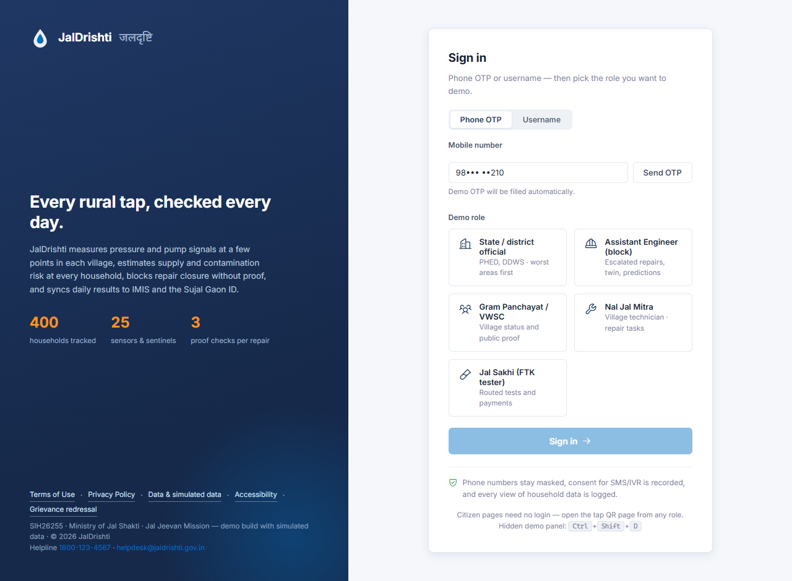
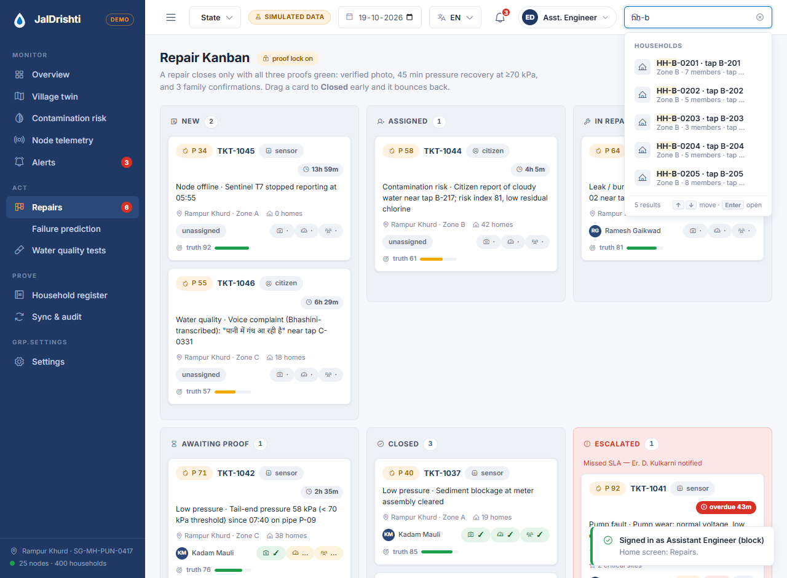
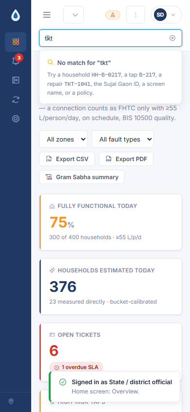
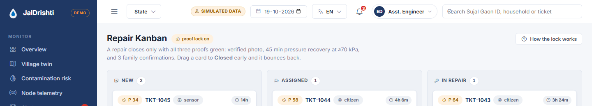
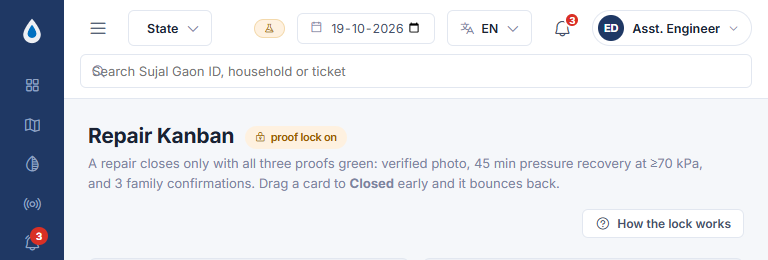
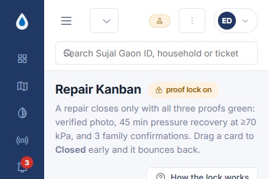

# JalDrishti · जलदृष्टि

**Rural tap-water monitoring dashboard for the Jal Jeevan Mission (FHTC)** — SIH26255, Ministry of Jal Shakti.

JalDrishti gives village technicians, block engineers, Gram Panchayat and district officials a single screen for continuous FHTC (Functional Household Tap Connection) monitoring: pressure telemetry, contamination risk, proof-locked repairs, water-quality tests and government sync — plus public, citizen-facing proof pages.

> **This is a prototype.** Every number on screen comes from a seeded, deterministic simulator (demo village *Rampur Khurd*, Maharashtra — 400 households, zones A/B/C, 25 sensor nodes, 1 borewell pump + 1 overhead tank). No real household data is used.

## Quick start

No build step, no dependencies. Either:

- **Open `index.html` directly** in a browser, or
- Serve the folder: `npx serve .` / `python -m http.server`

Sign in with any role on the login screen — each role gets a different, permission-filtered set of screens.

## Roles

| Role | Who | Home screen |
|---|---|---|
| **State / district official** | PHED, DDWS — worst areas first | Overview |
| **Assistant Engineer (block)** | Escalated repairs, digital twin, predictions | Repair Kanban |
| **Gram Panchayat / VWSC** | Village status and public proof | Overview |
| **Nal Jal Mitra** | Village technician — repair tasks | Repair tasks |
| **Jal Sakhi (FTK tester)** | Field water-testing — routed tests & payments | Routed tests |

Citizen pages (tap QR page, public proof) are public and reachable without a role.

## Features

- **Village digital twin** — SVG map of Rampur Khurd with households, nodes, zones and critical landmarks (school, Anganwadi, health sub-centre), with switchable layers.
- **Node telemetry & alerts** — live pressure/flow feed, alert inbox with severity and SLA timers.
- **Contamination risk** — per-tap risk scores with a risk choropleth.
- **Failure prediction** — early-warning cards for pump/line failures.
- **Repair Kanban with a proof lock** — drag-and-drop tickets; a repair only counts as closed with fresh geo-tagged photos (reused photos are rejected — see the *Demo panel* scenario).
- **Water-quality tests** — routed field tests with sample tracking.
- **Household register** — 400 seeded households, masked names/phones.
- **Sync & audit** — offline-first sync log and immutable audit trail.
- **Demo panel** (`#demo`) — trigger scenarios on demand: pump fault, low pressure, contamination spike, node offline, reused-photo lock test, family confirmations.
- **Trilingual UI** — English, हिन्दी, मराठी.
- **Accessibility & legal pages built in** — Terms, Privacy, Data & simulated data, Accessibility statement, Grievance redressal.

## Project layout

```
index.html              single-page entry
css/styles.css          all styling
js/util.js              small helpers (seeded RNG, formatting, i18n)
js/data.js              mock data model (9 entities) + village/scenario engine
js/shell.js             app shell: roles, routing, nav, search, top bar
js/screens-core.js      overview, twin, risk, telemetry, alerts, register, sync…
js/screens-admin.js     kanban, prediction, tests, settings, Gram Sabha summary
js/screens-mobile.js    field/mobile screens (tasks, tests, QR, proof), login
js/legal.js             legal & public pages
js/app.js               entry point — boots DB and shell
assets/                 self-hosted fonts (Inter, Noto Devanagari) + Phosphor icons
polish-shots/           UI screenshots (desktop & phone)
topbar-shots/           responsive top-bar screenshots
JalDrishti Software & Dashboard Specification.docx   full product spec
```

## Screenshots

<details>
<summary>Polish shots</summary>





</details>

<details>
<summary>Top bar at different widths</summary>





</details>

## Tech

Plain HTML/CSS/JS — no framework, no bundler, no package manager. Works offline; fonts and icons are self-hosted.
